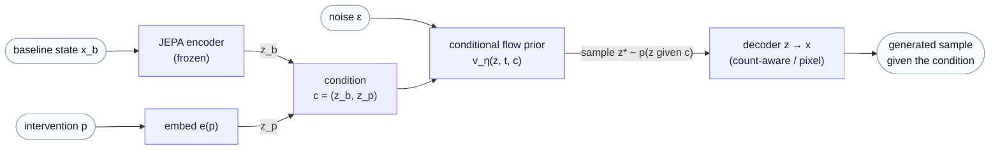

# ssl-lab

[](https://pleiadian53.github.io/ssl-lab/)

📖 **Documentation site (full math rendering):** <https://pleiadian53.github.io/ssl-lab/>

ssl-lab develops new methods for **generating biological data that can be trusted like measured data**. Generative models already produce convincing images and video. The goal here is the same capability for experiments: given a biological system and an intervention, generate the dataset the experiment would have produced, accurately enough to explore, prioritize and partly replace work that today needs new sequencing runs or extra assays.

The flagship target is **single-cell perturbation data**. Given a population of cells and a genetic perturbation, possibly a combination nobody has run, the model generates the perturbed population: which genes move, by how much, and how much the response varies from cell to cell. The same aim carries to other modalities, including physiological signals, health records and molecular structure.

**Reliable is measured, not assumed.** Generated data are scored on the direction and the size of the effects they predict and on whether the generated populations are calibrated, always against strong references: a model of the same task trained from scratch, and a training-free baseline that a useful generator must beat.

**The method line: self-supervised representations made generative.** The current build starts from JEPA (joint-embedding predictive architectures), a state-of-the-art self-supervised learner that predicts the *embeddings* of masked regions from their context instead of reconstructing raw data. On its own JEPA learns representations and cannot generate. To sample data the lab adds a **prior** over the latent and a **decoder** back to data space, matched to the data's likelihood. JEPA is the starting point because it is the frontier most worth extending, not a fixed commitment: each component is kept only where it earns its place against those references, and the aim is methods at and beyond the state of the art in both self-supervised learning and generative modeling.

A design-space survey of how to make JEPA generative recommends a **conditional flow prior**: generation *given a condition*, such as a perturbation or an intervention, paired with a decoder matched to the data. That conditional architecture is the one shown below.



> The unconditional generative slice is built and verified end to end, and the conditional flow prior, i.e. the `v(z, t, c)` path with classifier-free guidance, is implemented and method-de-risked. The method is modality-agnostic; its applications (single-cell perturbation, digital phenotyping, and more) and the full design space are the **[Generative JEPA series](docs/generative_jepa/index.md)** and [Research directions](#research-directions) below.

This *generative* slice is one of **two complementary extensions of JEPA** the lab pursues. The second turns JEPA from a passive predictor into an *active* world-model, described under [Research directions](#research-directions) below. The two are beginning to **converge**: the condition a generative JEPA samples under can be an *action*, and an action read as a latent **operator** is exactly the world-model line. So "generate the outcome of an intervention" and "plan the intervention" become two faces of one model.

## Why ssl-lab exists

ssl-lab is a spin-off of its sibling project [genai-lab](https://github.com/pleiadian53/genai-lab) (generative AI for computational biology). It is where new methods for self-supervised and generative modeling are developed and stress-tested, starting from JEPA and the ideas built around it. The core is kept deliberately **modality-agnostic**, so a method proven on one kind of biological data can move to the next through a data adapter. Methods mature here and return to genai-lab as **genomic generative models** that can stand in for, and help plan, real experiments.

## Research directions

JEPA is a *representation learner*: it learns by predicting the embeddings of masked regions from context. ssl-lab pushes it past that in two complementary ways:

**1. Generative JEPA: make the representation *sampleable*.** *(method built + de-risked; design space mapped; applications WIP)* Add a prior over the latent and a decoder back to data space. The unconditional slice is verified end to end, with a rich, non-collapsed latent (strong linear-probe accuracy with no pretraining labels) and *genuinely novel* samples. A full **[Generative JEPA design-space survey](docs/generative_jepa/index.md)** then maps four routes for making JEPA generative: decode the latent, a variational posterior, conditioned diffusion, and planning on top. It adds the **conditional flow prior** that unifies them: generation *given an intervention*, with a decoder matched to the data's likelihood. The method is modality-agnostic, and the conditional `v(z, t, c)` path is de-risked as a method; the applications are where it earns its keep:

- **Single-cell perturbation response** *(flagship, WIP)*: a staged "cell JEPA": intra-cell pretraining (Stage A) → variational / conditional-flow perturbation predictor (Stage B) → NB/ZINB count decoder (Stage C), on Norman-2019 Perturb-seq, graded on *effect size* (predicting unseen gene combinations) against a from-scratch CVAE baseline. An action-operator transition, an oracle ceiling, a decoder calibration fix and an encoder co-adaptation program have since extended it. Training the encoder together with the decoder brought the full pipeline level with the from-scratch baseline on the size of the predicted change, though not yet on its correlation, and no learned model yet beats the training-free additive reference. The pretraining itself is not shown to contribute at full data, which leaves label- and data-scarce settings as the place where it has to earn its keep. The [results ledger](examples/perturbation_response/docs/results/index.md) tracks every round.
- **Digital phenotyping**: e.g. diabetes monitoring and management, where the rollout becomes a *generative personal world model*: a fan of plausible future trajectories under an intervention (this is also where Direction 2's world model meets the generative line).
- **Further modalities**: the core is a likelihood-matched conditional generator, so new domains drop in as data adapters; the [data-modalities primer](docs/generative_jepa/appendix-data-modalities.md) surveys single-cell counts, EHR codes, and wearable / CGM streams.

**2. Action operators on JEPA: make prediction *active*.** *(research line: tutorial corpus written; theory still developing)* Go from passively in-filling hidden regions to *acting on* them. JEPA's predictor already *is* a latent operator, but its query is a **frozen, blind action**: it says only *where* or *when* to predict, never *what acted*. Promote that query to a **learned operator the model chooses and conditions on**, for both *sensing* ("where should I look?") and *perturbing* ("what happens under this intervention?"), and the passive predictor becomes a controllable **world model**: it can roll futures forward, run counterfactuals ("what if more sleep?"), and surface change that known interventions don't explain. This builds on the **action-operator** formalism from the sibling project [GRL](https://github.com/pleiadian53/GRL), and spans two application poles: continuous behavioral / mental-health monitoring (operator structure *learned*) and protein structure & dynamics (structure *given* by SE(3)).

> 📄 **Tutorial series** (full math on the [documentation site](https://pleiadian53.github.io/ssl-lab/)): three parts, read in this order:
> - **[Time-Series JEPA](docs/time_series_jepa/index.md)**: the substrate, covering JEPA pointed at time series, multimodal channels, and the one blind spot that motivates operators. Its first runnable instance is the [ECG rhythm study](examples/ecg_rhythm/README.md).
> - **[Action Operators](docs/action_operator/00-from-actions-to-operators.md)**: the foundation, covering what an action operator is, why JEPA benefits from one, and a gallery of concrete operators.
> - **[Operator World Models](docs/operator_world_models/index.md)**: the synthesis, which conditions the predictor on *what acted* for counterfactual rollout, composable interventions, and a sharpened change signal.
>
> *Status: an actively developing theoretical line whose operator formalism is still being worked out, not settled. It now reaches into Direction 1. The [Generative JEPA series](docs/generative_jepa/index.md) treats action-conditioning as the bridge: the conditional flow prior's condition can be an action, and Route D's planner is an action operator, so the generative and world-model lines are converging on one substrate.*

A concrete motivation in genomics: given an RNA sequence, *sense* to localize candidate splice sites, then *perturb* (in-silico edits / mutations) to learn what they do to splicing. That is the kind of active, hypothesis-driven understanding passive prediction alone can't reach.

## Studies so far

Two applied studies have run so far. Each is pre-registered, compares arms within one study, and reports uncertainty alongside every number. Besides their own questions, together they answer a narrower one: what JEPA pretraining buys over training the same model from scratch.

- **[Single-cell perturbation response](examples/perturbation_response/README.md)** (Norman 2019 Perturb-seq, twenty held-out two-gene combinations). The task is to generate the perturbed cell population for gene combinations never measured. The generative stack, a JEPA cell encoder with a conditional flow and a count decoder, is graded against a from-scratch conditional NB-VAE and a training-free additive reference. At full data, the from-scratch baseline and additivity lead, and an encoder trained jointly with the decoder from random weights does at least as well as one started from the JEPA weights. The [results ledger](examples/perturbation_response/docs/results/index.md) holds every round.
- **[ECG rhythm classification](examples/ecg_rhythm/README.md)** (PTB-XL, 21,799 twelve-lead ECGs). Span-masked JEPA pretraining is compared with the same encoder trained from scratch, at nested label budgets. With labels for 5% of training patients, pretraining adds 0.078 macro AUROC, and the advantage shrinks to a tie when every patient is labelled ([results](examples/ecg_rhythm/results/01-jepa-label-efficiency/README.md)).

Read together, the two studies point the same way. Pretraining pays off when labels are scarce and fades when they are plentiful, so label and data efficiency is the axis on which the perturbation study's pretraining is still to be tested.

## Related projects

ssl-lab sits in a small constellation of related work:

- **[genai-lab](https://github.com/pleiadian53/genai-lab)**: the parent project, focused on generative AI for computational biology. ssl-lab matures methods here and feeds them back to genai-lab for genomic generative models.

- **[NMDiff](https://github.com/pleiadian53/nmdiff)**: a **distinct branch of SSL** that sits outside the three classical families. Contrastive (SimCLR/CLIP), predictive (BERT/GPT/MAE), and self-distillation (BYOL/DINO) methods all share one structural property: the labeling function `T` is *fixed*, and only the encoder is learned. NMDiff promotes `T` itself to a domain-parameterized hypothesis `L(·; θ)` and jointly optimizes it with the downstream classifier via an outer-loop cross-view AUC criterion. The labeling function isn't a hyperparameter; it *is* the scientific hypothesis. Call it **hypothesis-driven SSL**: applied to transcript NMD efficiency (where ground-truth labels don't exist), but the pattern generalizes to any label-scarce setting where domain knowledge can parameterize a candidate labeling. Within the 2026 macro-trend of *learning the supervision signal itself*, which also includes self-improving SSL, learned-augmentation SSL, and programmatic weak supervision, NMDiff is the interpretable, low-dimensional, domain-knowledge instance.

- **[GRL](https://github.com/pleiadian53/GRL)**: origin of the action-operator formalism that grounds the action-operator research direction above.

- **[protein-ml-lab](https://github.com/pleiadian53/protein-ml-lab)** *(sibling, early work in progress)*: new methods for protein modeling and design across the protein-ML stack (ESM, the AlphaFold lineage, RFdiffusion / ProteinMPNN / Chroma). It is the natural home for the action operator's **"given" pole**: there the operators are the rotations and translations of a molecule in 3D space, honest **SE(3)** group elements known in advance, so equivariance is *demanded* rather than learned, and frame-based structure prediction and generation are *operators on SE(3)* made literal (AlphaFold's residue frames, FrameDiff/RFdiffusion flows). Where ssl-lab's operators are **learned** from data, protein-ml-lab's are **known in advance**. These are the two poles of the same expressiveness↔structure dial, in two sibling repos.

- **[tabular-icl-lab](https://github.com/pleiadian53/tabular-icl-lab)** *(sibling, early work in progress)*: tabular foundation models and in-context learning (TabPFN) for computational biology, as strong small-data references, evaluation probes and carriers of domain priors. Its first route asks whether a tabular in-context learner can predict what additivity misses in the perturbation study.

## Layout

This project follows a use-case-driven R&D convention: reusable primitives in `src/`, thin driver scripts in `examples/`, intuition in `notebooks/`.

```
src/ssllab/
  data/        image-proxy, single-cell Perturb-seq and PTB-XL ECG adapters -> modality-agnostic
               token tensors (signal geometry in physical time; a checksummed WFDB reader)
  models/      TinyViT backbone, JEPA encoder/predictor, latent decoder
  jepa/        block masking, EMA target, the assembled JEPA module
  objectives/  prediction loss + VICReg collapse regularizer
  generative/  flow prior (unconditional + conditional w/ classifier-free guidance),
               NB/ZINB count decoder, condition encoder, CVAE baseline,
               perturbation action operator (+ operator algebra)
  action_operator/  context-conditioned latent operators — generator bases, exp(M)
  eval/        collapse diagnostics, linear probe, effect size, calibration and population metrics,
               interaction scores, joint paired bootstrap with max-t intervals, image-grid viz
  coadapt.py   joint encoder + decoder training (decoder only, joint, joint with the JEPA anchor)
  anatomy/     step-by-step shape traces of every component, for the architecture viewer
  utils/       seeding, device selection
examples/
  jepa_basics/          01 train JEPA · 02 linear probe
  generative_jepa/      03 decoder · 04 flow prior · 05 sample · 06 eval ·
                        07 conditional flow · 08 sample conditional   (image proxy)
  perturbation_response/  cell-JEPA perturbation pipeline (WIP): process Norman ->
                        Stage A pretrain -> count decoder -> conditional flow
                        or action operator -> sample -> effect-size eval
                        (+ CVAE and additive references, ceiling analysis, one scoring
                        script per pre-registered round); co-adaptation/ trains the encoder
                        with the stages that read it
  ecg_rhythm/           PTB-XL: process -> data card -> labelled-patient subsets -> span-masked
                        JEPA pretraining -> scratch / fine-tune / probe arms -> paired
                        patient-cluster bootstrap -> results page
```

## Setup

```bash
mamba env create -f environment.yml    # or: conda env create -f environment.yml
conda activate ssllab
pip install -e .
```

## Run the vertical slice

```bash
# 1. learn the representation (prints collapse diagnostics each epoch)
python examples/jepa_basics/01_train_jepa_mnist.py --epochs 5

# 2. confirm the frozen latent is semantically useful
python examples/jepa_basics/02_linear_probe.py

# 3. learn to decode the frozen latent back to pixels
python examples/generative_jepa/03_train_decoder.py --epochs 5

# 4. learn a sampleable prior over the frozen latent
python examples/generative_jepa/04_train_flow_prior.py --epochs 20

# 5. sample z ~ prior, decode -> output/jepa_mnist/samples/samples.png
python examples/generative_jepa/05_sample_and_decode.py
```

Artifacts are organized per experiment under `output/<experiment>/`:

```
output/jepa_mnist/
  checkpoints/  encoder.pt  decoder.pt  prior.pt
  samples/      samples.png  recon.png
  reports/      jepa_train.json  probe.json
  logs/         train.log
```

On a GPU pod this same tree is written under the network volume (`/runpod-volume/ssl-lab/output/<experiment>/`) and rsynced back to the local `output/`: same structure, env-dependent prefix swapped.

All scripts share an `--experiment` name (default `jepa_mnist`); pass a new name to keep separate runs side by side. On a GPU pod, the whole chain runs via `examples/generative_jepa/run_pod_pipeline.sh`.

## Remote training

Models that don't fit in your local environment train on remote GPU pods. That infra lives in a separate, decoupled package [`ops/`](ops/) (SkyPilot + RunPod). The SSL library never imports it. Quick path:

```bash
pip install -e ops/                          # compute-check + dry-run
python examples/ops/ops_compute_check.py     # local vs pod?
python examples/ops/ops_run_pipeline.py --gpu a40 -- \
    python examples/jepa_basics/01_train_jepa_mnist.py --epochs 50   # dry-run
```

See [ops/README.md](ops/README.md) for the full provision → run → fetch workflow.
