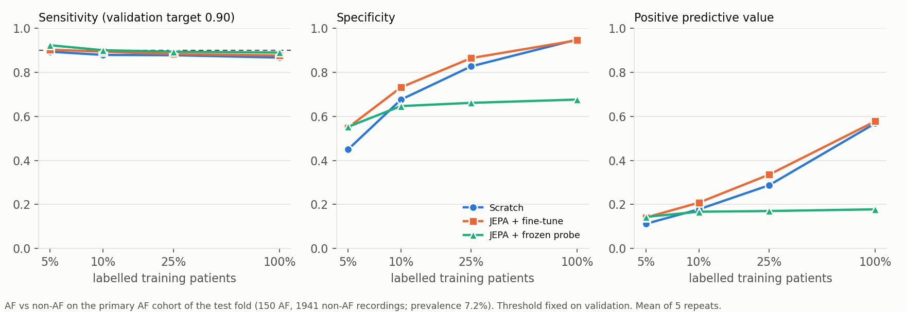

# 01 · JEPA label efficiency: does span-masked pretraining save labelled ECGs?

The first modelling setting of the [ECG rhythm](../../README.md) package, and the first entry in the [results index](../README.md). It compares three ways of training the same small transformer: from scratch, JEPA-pretrained then fine-tuned, and JEPA-pretrained with a frozen linear probe. Each is trained with labels for a growing share of training patients.

| | |
|---|---|
| Status | complete (2026-10-12) |
| Protocol | [`configs/study_v1.json`](../../configs/study_v1.json) with amendments [1](../../configs/study_v1_amend1.json) and [2](../../configs/study_v1_amend2.json) |
| Run outputs | `output/ecg_rhythm_v1/` (not committed) |
| This folder | regenerated from the frozen run outputs by [`08_make_results.py`](../../08_make_results.py), so no number below was typed by hand |

## 1. The question

A label for an ECG costs a cardiologist's time; an unlabelled ECG costs almost nothing. If a model can first learn useful structure from unlabelled recordings, it might need far fewer labelled patients to reach the same performance. This setting tests that idea in its simplest controlled form:

> With the same encoder, the same labelled patients and the same tuning procedure, how much does self-supervised JEPA pretraining improve rhythm classification, and how does the benefit change as more patients are labelled?

The analysis is a **label-efficiency study**: every model is trained at several fixed labelled-patient budgets and the resulting performance curves are compared.

## 2. The prediction task

**Input.** One ten-second, twelve-lead resting ECG, sampled at 100 Hz: a $12 \times 1000$ array of voltages. Each lead of each recording is standardised to zero mean and unit variance over time; no other filtering is applied.

**Output.** A multi-label prediction over PTB-XL's twelve **rhythm statements**, the part of the cardiologist's report that describes the heart's rhythm. The model has one independent sigmoid output per statement, because a recording can carry more than one rhythm statement, for example sinus rhythm with bigeminy.

| code | rhythm statement | role here |
|---|---|---|
| SR | sinus rhythm | core |
| AFIB | atrial fibrillation | core |
| STACH | sinus tachycardia | core |
| SARRH | sinus arrhythmia | core |
| SBRAD | sinus bradycardia | core |
| PACE | normal functioning artificial pacemaker | secondary |
| SVARR | supraventricular arrhythmia | secondary |
| BIGU | bigeminal pattern | secondary |
| AFLT | atrial flutter | secondary |
| SVTAC | supraventricular tachycardia | secondary |
| PSVT | paroxysmal supraventricular tachycardia | secondary |
| TRIGU | trigeminal pattern | secondary |

All twelve are trained. The **five core labels** are the ones the comparison is scored on. They were chosen before any model was evaluated: each has enough positive patients in the validation set to set thresholds, and in every planned training subset to learn from.

| core label | positive training patients | positive validation patients | share of test recordings |
|---|---|---|---|
| SR | 11,994 | 1,535 | 79.8% |
| AFIB | 991 | 124 | 7.3% |
| STACH | 623 | 80 | 3.9% |
| SARRH | 604 | 76 | 3.7% |
| SBRAD | 495 | 60 | 3.1% |

Three labelling rules apply throughout:

- **A statement counts as present whatever its recorded likelihood.** PTB-XL grades almost every rhythm statement with likelihood 0, which means "not graded", not "absent".
- **A recording with no rhythm statement is unknown, not negative.** These recordings are left out of every rhythm label, though pretraining may still use their waveforms.
- **Each recording keeps its own labels.** Even when the same patient has other recordings with different rhythms.

## 3. Data and splits

The data is [PTB-XL v1.0.3](https://physionet.org/content/ptb-xl/1.0.3/) (Wagner et al. 2020, *Scientific Data*; PhysioNet, CC BY 4.0). It holds 21,799 clinical recordings from 18,869 patients, every file checked against PhysioNet's published checksums.

PTB-XL ships ten stratified folds that keep **every patient in a single fold**, so no person appears on both sides of a split:

| split | folds | recordings | patients | recordings with a rhythm statement |
|---|---|---|---|---|
| train | 1–8 | 17,418 | 15,023 | 16,832 |
| validation | 9 | 2,183 | 1,942 | 2,100 |
| test | 10 | 2,198 | 1,904 | 2,098 |

Training data feeds pretraining and the labelled models. Validation is used for every choice: learning rates, early stopping and decision thresholds. The test fold was untouched until the final comparison.

## 4. Label budgets

Each model is trained with labels for **5%, 10%, 25% or 100%** of the 15,023 training patients. Budgets count *patients*, not recordings, so a selected patient brings all of their recordings, and the percentages are always relative to all training patients.

The subsets come from one seeded shuffle of the training patients per repeat. A budget takes the first part of that shuffle, so within a repeat the 5% patients are inside the 10%, the 10% inside the 25%, and so on. Every model sees exactly the same labelled patients. The patient ids are saved and pinned by hash.

| budget | patients selected | of whom have rhythm-annotated recordings | rhythm-annotated recordings | fewest positive patients for any core label |
|---|---|---|---|---|
| 5% | 752 | 725–733 | 820–853 | 21 (SARRH, SBRAD) |
| 10% | 1,503 | 1,453–1,461 | 1,650–1,698 | 39 (SBRAD) |
| 25% | 3,756 | 3,626–3,640 | 4,168–4,231 | 116 (SBRAD) |
| 100% | 15,023 | 14,574 | 16,832 | 495 (SBRAD) |

Ranges span the five repeats. Every core label has positive patients in every subset. A few rare secondary labels (AFLT, PSVT, TRIGU) have none in some small subsets. In those runs that output is masked out of training and recorded as unsupported, and it never enters a core score.

## 5. The three models

All three share one architecture.

- **Tokens.** The ten-second ECG is cut into 40 consecutive windows of 250 ms. Each window, all twelve leads together ($12 \times 25 = 300$ numbers), becomes one token.
- **Encoder.** A small transformer (a `JEPAEncoder`: 128-dimensional tokens, 4 layers, 4 attention heads) linearly embeds each token, adds a learned position embedding, and contextualises the 40 tokens.
- **Head.** The 40 output vectors are averaged into one 128-dimensional summary of the recording, and a single linear layer maps it to the twelve label scores.

What differs is how the encoder learns:

| model | encoder before labels | what is trained on labels |
|---|---|---|
| **Scratch** | random weights | encoder and head |
| **JEPA + fine-tune** | JEPA-pretrained | encoder and head |
| **JEPA + frozen probe** | JEPA-pretrained, then frozen | head only (a linear probe) |

**JEPA pretraining.** JEPA stands for Joint-Embedding Predictive Architecture.

- **The task.** The encoder sees each training recording with two contiguous one-second stretches hidden (four tokens each, 8 of the 40). A small predictor network must guess the *representations* of the hidden stretches, which a slowly updated copy of the encoder computes from the full recording. It predicts representations, not voltages.
- **Data.** No labels are used, and only training-fold recordings: all 17,418, including those without a rhythm statement. Validation and test never enter pretraining.
- **Settings.** 100 epochs, batch 128, learning rate 5e-4, with a small variance-covariance penalty against collapse.
- **Per repeat.** Pretraining runs independently in each repeat. The downstream models start from the trained encoder (the student network, which the checkpoint stores).

Scratch against fine-tune is the comparison that answers the question: same architecture, same labelled patients, same tuning. The frozen probe is a secondary readout of how much rhythm information pretraining has already put into the summary.

## 6. Training and selection protocol

**Shared training procedure.** Every labelled training run uses:

- AdamW, weight decay 0.05, batch 64;
- a cosine schedule with a 100-step warm-up;
- a binary cross-entropy loss over the twelve outputs, with no class weighting;
- at most 4,000 steps, with validation every 100 steps and early stopping after 10 evaluations without improvement;
- the checkpoint with the best **validation core macro AUROC** (section 7).

**Learning rates.** All three models drew their rate from one shared grid, {1e-4, 3e-4, 1e-3, 3e-3, 1e-2}, using the same rule: the best validation score at the 10% budget in repeat 0. The rate was then frozen for every budget and repeat. Selected rates: **scratch 3e-3, fine-tune 3e-4, probe 1e-3**, all inside the grid.

**Repeats.** The whole comparison is repeated **five times**. Each repeat changes three things together:

- the labelled-patient subsets (a new shuffle);
- the training seed (head initialisation, the scratch encoder's initialisation, batch order);
- an independent JEPA pretraining run.

At the 100% budget every repeat uses the same patients, and only the training randomness differs.

## 7. Evaluation

**Primary metric.** The **core macro AUROC**, the AUROC averaged over the five core labels:

$$\overline{\mathrm{AUROC}} = \frac{1}{5} \sum_{c \in \mathcal{C}} \mathrm{AUROC}_c ,$$

where $\mathcal{C}$ = {SR, AFIB, STACH, SARRH, SBRAD} and $\mathrm{AUROC}_c$ is the area under the ROC curve for label $c$. It is computed over the 2,098 test recordings that carry a rhythm statement. An AUROC of 0.5 is chance and 1.0 is perfect ranking.

**Uncertainty, kept as two separate quantities.**

- **Test-patient sampling.** A paired patient-cluster bootstrap with 2,000 resamples. Test patients are drawn with replacement, together with all their recordings, and both methods are rescored on each resample.
- **Training randomness.** The spread of results across the five repeats.

**AF operating point.** For atrial fibrillation, a yes/no threshold is set on the validation fold by a rule fixed in advance: the highest threshold that keeps validation sensitivity at or above 0.90. That threshold is then applied unchanged to the test fold. This uses a slightly narrower cohort that also leaves out the 7 test recordings carrying atrial flutter: 2,091 recordings, 150 with AF (7.2%). "Non-AF" means an ECG without AF from a hospital population, not a healthy control.

## 8. Results

### Pretraining saves labels, and the saving shrinks as labels grow


Core macro AUROC on the test fold, mean ± standard deviation over the five repeats:

| | 5% | 10% | 25% | 100% |
|---|---|---|---|---|
| Scratch | 0.712 ± 0.019 | 0.753 ± 0.013 | 0.821 ± 0.015 | 0.881 ± 0.001 |
| JEPA + fine-tune | 0.789 ± 0.017 | 0.814 ± 0.015 | 0.849 ± 0.018 | 0.886 ± 0.005 |
| JEPA + frozen probe | 0.811 ± 0.017 | 0.828 ± 0.014 | 0.838 ± 0.012 | 0.846 ± 0.007 |

With labels for 5% of patients, the fine-tuned pretrained encoder scores 0.789. Scratch training does not reach that until somewhere between 10% and 25% of patients. With every patient labelled, the two are tied.

### The primary comparison, with its uncertainty


For a budget $b$ and repeat $r$, let $\Delta_{b,r}$ be the fine-tuned score minus the scratch score on the same test recordings, and $\bar{\Delta}_b$ its mean over the five repeats.

**JEPA + fine-tune − scratch**

| budget | mean difference | 95% interval (test patients) | repeat SD | repeats above 0 |
|---|---|---|---|---|
| 5% | +0.078 | [+0.064, +0.091] | 0.023 | 5 / 5 |
| 10% | +0.060 | [+0.048, +0.073] | 0.016 | 5 / 5 |
| 25% | +0.028 | [+0.018, +0.039] | 0.008 | 5 / 5 |
| 100% | +0.004 | [-0.005, +0.013] | 0.006 | 3 / 5 |

- **The interval** answers: *if a different set of test patients had been drawn, how much would $\bar{\Delta}_b$ move?* Every repeat is scored on the same resample, so the interval belongs to the five-repeat mean. It says nothing about training randomness.
- **The repeat SD** answers: *how much does the result change when training is redone?*

At 5%, 10% and 25%, the interval excludes zero and every repeat favours pretraining. At 100% the interval straddles zero and the repeats split three to two: a tie.

### The frozen probe is strongest when labels are scarcest

| comparison | 5% | 10% | 25% | 100% |
|---|---|---|---|---|
| frozen probe − scratch | +0.100 [+0.085, +0.114] | +0.075 [+0.061, +0.088] | +0.017 [+0.005, +0.030] | −0.035 [−0.047, −0.024] |
| fine-tune − frozen probe | −0.022 [−0.032, −0.012] | −0.015 [−0.024, −0.004] | +0.011 [+0.001, +0.021] | +0.040 [+0.028, +0.052] |

Brackets are 95% intervals over test patients, as above.

### Per-label results


Mean test AUROC over the five repeats, written as scratch / fine-tune / frozen probe:

| label | 5% | 10% | 25% | 100% |
|---|---|---|---|---|
| SR | 0.676 / 0.755 / 0.793 | 0.727 / 0.793 / 0.806 | 0.786 / 0.827 / 0.812 | 0.854 / 0.867 / 0.818 |
| AFIB | 0.788 / 0.831 / 0.847 | 0.866 / 0.894 / 0.870 | 0.927 / 0.940 / 0.879 | 0.968 / 0.968 / 0.883 |
| STACH | 0.807 / 0.920 / 0.948 | 0.875 / 0.947 / 0.957 | 0.940 / 0.961 / 0.965 | 0.981 / 0.982 / 0.969 |
| SARRH | 0.547 / 0.567 / 0.579 | 0.544 / 0.560 / 0.597 | 0.577 / 0.613 / 0.620 | 0.668 / 0.678 / 0.639 |
| SBRAD | 0.741 / 0.875 / 0.890 | 0.755 / 0.874 / 0.910 | 0.876 / 0.905 / 0.917 | 0.938 / 0.933 / 0.923 |

No per-label intervals were computed, so these per-label differences are descriptive.

### AF at a fixed operating point



| method | budget | sensitivity | specificity | PPV | NPV |
|---|---|---|---|---|---|
| Scratch | 5% | 0.893 | 0.449 | 0.112 | 0.982 |
| Scratch | 25% | 0.877 | 0.827 | 0.287 | 0.989 |
| Scratch | 100% | 0.867 | 0.949 | 0.568 | 0.989 |
| JEPA + fine-tune | 5% | 0.903 | 0.549 | 0.141 | 0.986 |
| JEPA + fine-tune | 25% | 0.883 | 0.864 | 0.335 | 0.990 |
| JEPA + fine-tune | 100% | 0.876 | 0.945 | 0.577 | 0.990 |
| JEPA + frozen probe | 5% | 0.923 | 0.552 | 0.144 | 0.989 |
| JEPA + frozen probe | 25% | 0.893 | 0.661 | 0.170 | 0.988 |
| JEPA + frozen probe | 100% | 0.889 | 0.676 | 0.178 | 0.987 |

All budgets, including 10%, are in [`metrics/af_operating_point.csv`](metrics/af_operating_point.csv). These are means over the five repeats, without bootstrap intervals.

## 9. Discussion

**Pretraining is a label saver, not a ceiling raiser, in this setting.** Its benefit is largest at 5% of patients, shrinks steadily, and vanishes once every patient is labelled. With enough labels, training from scratch reaches the same performance.

**A frozen probe on the pretrained features beats fine-tuning at the two smallest budgets, under this training procedure.** That procedure is one shared learning rate selected at the 10% budget, with no layer-wise rates and no gradual unfreezing. The pretrained summary already separates the rhythms well enough for a linear readout. From 25% upward the probe flattens out near 0.846 and ends below scratch at 100%: a frozen encoder cannot adapt when more labels arrive.

Why fine-tuning trails the probe at small budgets is not established. During learning-rate selection, fine-tuning reached its best validation score within about 200 steps and then declined, which is *consistent with* overfitting a small labelled set; that is an observation about training curves, not a tested explanation, and a gentler recipe might close the gap. The probe's best step often fell at the 4,000-step limit, but it had plateaued by then, gaining 0.0003 over its last 1,000 steps in the selection run.

**The gains are uneven across rhythms.** At 5% of patients, pretraining lifts sinus tachycardia from 0.807 to 0.920 and sinus bradycardia from 0.741 to 0.875. Both labels are defined largely by heart rate, so one plausible hypothesis is that span-masked pretraining makes the representation sensitive to heart rate. This study does not test that mechanism. A probe that predicts heart rate or RR intervals from the frozen summaries would. Atrial fibrillation gains less: +0.043 at 5%, +0.028 at 10%, and nothing at 100%.

Sinus arrhythmia is the weakest core label for every method at every budget. Its AUROC is limited at low budgets (0.54 to 0.62 from 5% to 25%) and modest even with every patient labelled (0.668 scratch, 0.678 fine-tune, 0.639 probe). This study does not explain why. The label stays in the average because the label set was fixed before any model was evaluated.

**At a fixed AF operating point, thresholds transfer reasonably and specificity improves with labels.** The validation-selected thresholds give roughly the intended test sensitivity, mostly just below 0.90. At the same sensitivity, the fine-tuned model is more specific than scratch at small budgets, so it raises fewer false alarms; with all patients labelled, the two match. The frozen probe's specificity stalls near 0.68.

Positive predictive value is low at small budgets for two reasons acting together: AF is uncommon in this cohort, and specificity there is low. At 5%, a specificity near 0.55 means about 45% of non-AF recordings are flagged positive, roughly six to eight false alarms for every AF recording correctly detected. These AF results are promising but they are not deployment evidence: they come from a retrospective benchmark of ten-second clinical recordings, they carry no bootstrap intervals, and calibration has not been assessed.

## 10. What this setting does not show

- **JEPA against other self-supervised objectives.** There is no contrastive or reconstruction arm, so the evidence is about JEPA pretraining against no pretraining only.
- **Generality beyond this setting.** One dataset (PTB-XL), one sampling rate (100 Hz), twelve leads, ten-second resting recordings, one encoder architecture. Long ambulatory recordings, single-lead devices and other populations are untested.
- **Calibration or robustness.** Neither probability calibration nor robustness to noise and recording artefacts has been evaluated.
- **Per-label certainty.** Intervals were computed for the five-label average, not for each label.

## 11. How the comparison was protected

- **Patient-level separation.** Every patient sits in one fold. Pretraining saw training recordings only.
- **Fixed before evaluation.** The core labels, budgets and repeats were chosen from patient counts in training and validation, then frozen. No label was dropped and no budget changed after any model was scored.
- **Paired subsets.** Within a repeat, every method trained on exactly the same labelled patients.
- **Comparable tuning.** All three methods used the same learning-rate grid and selection rule.
- **Two disclosed amendments.** The learning-rate grid was widened twice, both times on validation evidence alone. First, the pilot's grid stopped short of fine-tuning's best rate. Second, the scratch baseline then selected the top of the widened grid. The final grid was declared final in advance. Both amendments are separate files linked by hash to the untouched original protocol. The test fold played no part in either.
- **Healthy pretraining.** All five independent pretraining runs ended with an effective rank of 94 to 102 out of 128 dimensions, so none of the representations collapsed.

## 12. Next steps

Setting 01 answers its question for one objective, one architecture and twelve leads. The next settings can push in different directions, and which comes first is still open.

**Tighten the claims of setting 01, with no new models:**

- **Heart-rate probe.** Test the heart-rate hypothesis directly by predicting heart rate and RR variability from the frozen summaries.
- **Calibration and robustness.** Assess calibration with reliability curves and temperature scaling fitted on validation. Assess robustness by scoring the same models on recordings with added noise, baseline wander and dropped segments, and on the dataset's own noisy recordings.

**Candidates for setting 02, a second modelling approach:**

- **A better fine-tuning recipe.** For example a lower learning rate at small budgets, layer-wise learning rates, or training the linear probe first and then fine-tuning. This asks whether fine-tuning can match the frozen probe when labels are scarce.
- **Single-lead input.** The same comparison using lead II alone. This asks how much rhythm information survives in one channel, the setting closest to wearable monitors.
- **A second self-supervised objective.** A contrastive or masked-reconstruction comparator, to say something about JEPA relative to other objectives rather than only against no pretraining.
- **External validation.** Evaluating the trained models on an independent dataset such as the PhysioNet/CinC 2017 single-lead recordings, which changes device, population and recording length at once.

**One caution applies to all of these.** The test fold has now been examined. Any new setting should make every choice on validation data alone, and a claim of improvement over setting 01 is best confirmed on data neither setting has seen.

## Reproduce

```bash
python examples/ecg_rhythm/06_compare_arms.py --tag main --split test --jobs 6    # paired bootstrap, from saved predictions
python examples/ecg_rhythm/08_make_results.py                                     # this folder's figures and metrics
```

The full pipeline, from data processing through pretraining and the grid, is described in the [package README](../../README.md).

## Files

| file | contents |
|---|---|
| `figures/label_efficiency.png` | core macro AUROC by budget, three methods, individual repeats |
| `figures/paired_differences.png` | differences against scratch with test-patient intervals |
| `figures/per_label_auroc.png` | the five core labels |
| `figures/af_operating_point.png` | AF sensitivity, specificity and PPV at the validation threshold |
| `metrics/summary.json` | curated numbers, selected rates, pretraining diagnostics, protocol hashes |
| `metrics/per_run.csv` | all 60 runs: test and validation scores, best step, training-set size |
| `metrics/pairs.csv` | every paired difference, per repeat and for the mean |
| `metrics/per_label.csv` | per-label AUROC and AUPRC, mean over repeats, with prevalence |
| `metrics/af_operating_point.csv` | AF threshold and test operating point for every run |
| `metrics/tables.md` | the result tables, as generated |
