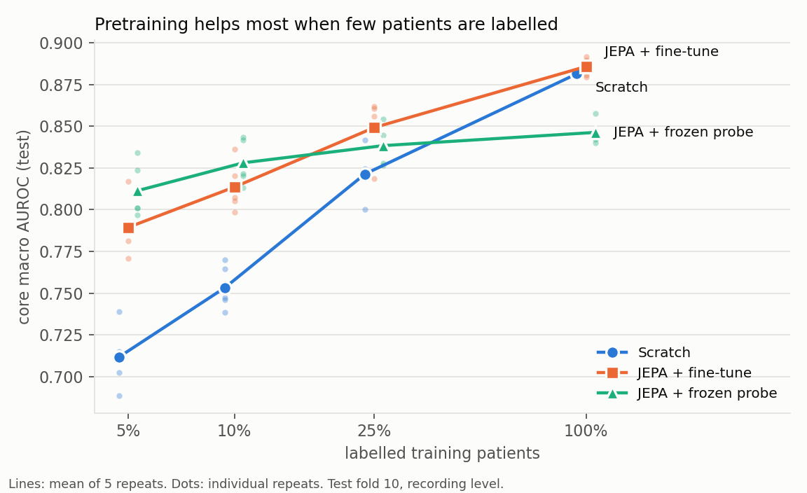
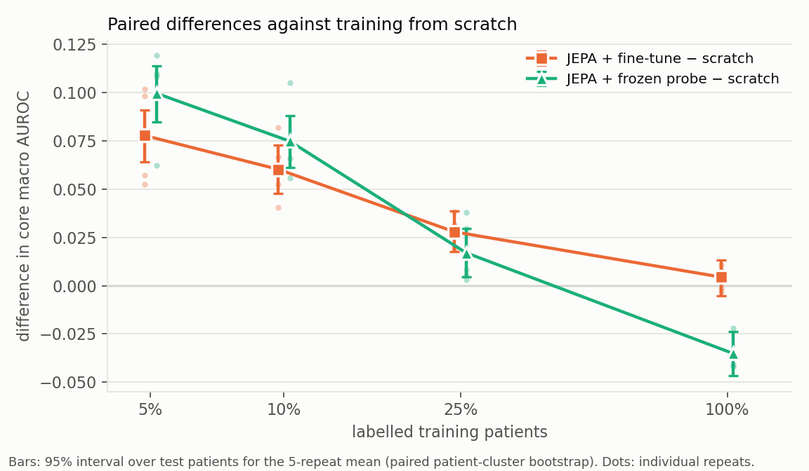
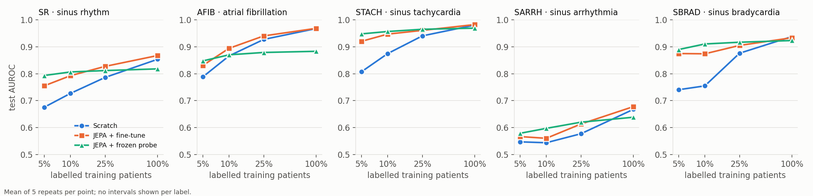

# Results: does span-masked JEPA pretraining help ECG rhythm classification?

Interpretation ledger for study v1 of the [ECG rhythm](../README.md) package. The raw artifacts live under `output/ecg_rhythm_v1/` (not committed). This folder holds the committed interpretation, the figures, and the curated metrics, all regenerated from the frozen run outputs by [`08_make_results.py`](../08_make_results.py), so no number below was typed by hand.

## The question

A label for an ECG costs a cardiologist's time; an unlabelled ECG costs nothing. If a model can learn useful structure from unlabelled recordings first, it might need far fewer labelled patients to reach the same accuracy. Study v1 tests that idea in its simplest controlled form.

The same small transformer encoder is trained three ways:

- **Scratch.** The encoder starts from random weights and learns only from labelled recordings.
- **JEPA + fine-tune.** The encoder is first pretrained with span-masked JEPA on the training recordings, with labels hidden, then all of its weights are trained on the labelled recordings.
- **JEPA + frozen probe.** The same pretrained encoder is frozen; only a linear layer on top is trained.

In span-masked JEPA, the encoder sees a 10 s ECG with two 1 s stretches hidden, and a predictor must guess the *representation* of the hidden stretches, not their voltages. The comparison that answers the question is fine-tune against scratch: same architecture, same labelled patients, same tuning procedure. The frozen probe is a secondary readout of what the pretrained features already contain.

Each method is trained with labels for 5%, 10%, 25% and 100% of the 15,023 training patients, five times over (five *repeats*), and scored on the held-out test fold.

## Headline



The score is the **core macro AUROC**: the AUROC averaged over the five core rhythm labels,

$$\overline{\mathrm{AUROC}} = \frac{1}{5} \sum_{c \in \mathcal{C}} \mathrm{AUROC}_c ,$$

where $\mathcal{C}$ = {SR, AFIB, STACH, SARRH, SBRAD} (sinus rhythm, atrial fibrillation, sinus tachycardia, sinus arrhythmia, sinus bradycardia) and $\mathrm{AUROC}_c$ is the area under the ROC curve for label $c$, computed over the recordings of the test fold. An AUROC of 0.5 is chance and 1.0 is perfect ranking.

Mean ± standard deviation over the five repeats:

| | 5% | 10% | 25% | 100% |
|---|---|---|---|---|
| Scratch | 0.712 ± 0.019 | 0.753 ± 0.013 | 0.821 ± 0.015 | 0.881 ± 0.001 |
| JEPA + fine-tune | 0.789 ± 0.017 | 0.814 ± 0.015 | 0.849 ± 0.018 | 0.886 ± 0.005 |
| JEPA + frozen probe | 0.811 ± 0.017 | 0.828 ± 0.014 | 0.838 ± 0.012 | 0.846 ± 0.007 |

**Pretraining helps most when labels are scarce, and the benefit fades as labels become plentiful.** With labels for 5% of patients, the fine-tuned pretrained encoder scores 0.789, which scratch training does not reach until somewhere between 10% and 25% of patients. With every patient labelled, the two are tied.

## The primary comparison, with its uncertainty



For a budget $b$ and repeat $r$, let $\Delta_{b,r}$ be the fine-tuned score minus the scratch score, both computed on the same test recordings. The table reports the mean over the five repeats, $\bar{\Delta}_b$.

**JEPA + fine-tune − scratch**

| budget | mean difference | 95% interval (test patients) | repeat SD | repeats above 0 |
|---|---|---|---|---|
| 5% | +0.078 | [+0.064, +0.091] | 0.023 | 5 / 5 |
| 10% | +0.060 | [+0.048, +0.073] | 0.016 | 5 / 5 |
| 25% | +0.028 | [+0.018, +0.039] | 0.008 | 5 / 5 |
| 100% | +0.004 | [-0.005, +0.013] | 0.006 | 3 / 5 |

Two different kinds of uncertainty appear here, and they are kept apart on purpose.

- **The interval** answers: *if a different set of test patients had been drawn, how much would $\bar{\Delta}_b$ move?* It comes from a paired patient-cluster bootstrap. Test patients are resampled with replacement, together with all of their recordings, and both methods are rescored on each resample, 2,000 times. Every repeat is scored on the same resample, so the interval belongs to the five-repeat mean. It says nothing about training randomness.
- **The repeat SD** answers: *how much does the result change when training is redone?* Each repeat draws a different labelled-patient subset, uses a different training seed, and runs its own independent JEPA pretraining. The SD of $\Delta_{b,r}$ across repeats measures that variability.

At 5%, 10% and 25%, the interval excludes zero and every one of the five repeats favours pretraining. At 100% the interval straddles zero and the repeats split three to two: a tie, which is what a fully labelled training set would be expected to produce.

## What else the results show

### The frozen probe wins when labels are scarcest, then stalls

| comparison | 5% | 10% | 25% | 100% |
|---|---|---|---|---|
| frozen probe − scratch | +0.100 [+0.085, +0.114] | +0.075 [+0.061, +0.088] | +0.017 [+0.005, +0.030] | −0.035 [−0.047, −0.024] |
| fine-tune − frozen probe | −0.022 [−0.032, −0.012] | −0.015 [−0.024, −0.004] | +0.011 [+0.001, +0.021] | +0.040 [+0.028, +0.052] |

Brackets are 95% intervals over test patients, as above.

With 5% and 10% of patients labelled, simply training a linear layer on the frozen pretrained features beats fine-tuning the whole encoder. Above that, the probe flattens out near 0.846 and ends below scratch training at 100%. The pretrained representation already separates the rhythms well enough for a linear readout, but a frozen encoder cannot adapt further when more labels arrive.

The probe's early advantage is consistent with fine-tuning overfitting a small labelled set. During learning-rate selection, fine-tuning reached its best validation score within about 200 optimisation steps and declined afterwards. That is an observation about training curves, not a tested explanation. The probe's best step also often fell at the 4,000-step limit, but its validation score had stopped improving by then: it rose by 0.0003 over the last 1,000 steps in the selection run.

### The gains are not spread evenly across rhythms



Mean test AUROC over the five repeats, written as scratch / fine-tune / frozen probe:

| label | 5% | 10% | 25% | 100% |
|---|---|---|---|---|
| SR | 0.676 / 0.755 / 0.793 | 0.727 / 0.793 / 0.806 | 0.786 / 0.827 / 0.812 | 0.854 / 0.867 / 0.818 |
| AFIB | 0.788 / 0.831 / 0.847 | 0.866 / 0.894 / 0.870 | 0.927 / 0.940 / 0.879 | 0.968 / 0.968 / 0.883 |
| STACH | 0.807 / 0.920 / 0.948 | 0.875 / 0.947 / 0.957 | 0.940 / 0.961 / 0.965 | 0.981 / 0.982 / 0.969 |
| SARRH | 0.547 / 0.567 / 0.579 | 0.544 / 0.560 / 0.597 | 0.577 / 0.613 / 0.620 | 0.668 / 0.678 / 0.639 |
| SBRAD | 0.741 / 0.875 / 0.890 | 0.755 / 0.874 / 0.910 | 0.876 / 0.905 / 0.917 | 0.938 / 0.933 / 0.923 |

The largest gains come from sinus tachycardia and sinus bradycardia. At 5% of patients, pretraining lifts STACH from 0.807 to 0.920 and SBRAD from 0.741 to 0.875. Both labels are defined largely by heart rate, which a model predicting hidden stretches of ECG has every reason to learn, since it must anticipate when the next beat falls. Atrial fibrillation gains less: +0.043 at 5%, +0.028 at 10%, and nothing at 100%. Sinus arrhythmia stays close to chance for every method at every budget; it is a subtle, breathing-driven variation that clinicians themselves grade inconsistently. It stays in the average because the label set was fixed before any model was evaluated. No per-label intervals were computed, so these per-label differences are descriptive.

### AF at a fixed operating point


A deployed classifier makes yes/no calls, not rankings. For the AF output, a threshold was chosen on the validation fold by a rule fixed in advance: the highest threshold that keeps validation sensitivity at or above 0.90. That threshold was then applied unchanged to the test fold. The test cohort excludes recordings with no rhythm statement and any recording carrying atrial flutter, leaving 150 AF and 1,941 non-AF recordings, a prevalence of 7.2%. "Non-AF" means an ECG without AF from a hospital population, not a healthy control.

| method | budget | sensitivity | specificity | PPV | NPV |
|---|---|---|---|---|---|
| Scratch | 5% | 0.893 | 0.449 | 0.112 | 0.982 |
| Scratch | 25% | 0.877 | 0.827 | 0.287 | 0.989 |
| Scratch | 100% | 0.867 | 0.949 | 0.568 | 0.989 |
| JEPA + fine-tune | 5% | 0.903 | 0.549 | 0.141 | 0.986 |
| JEPA + fine-tune | 25% | 0.883 | 0.864 | 0.335 | 0.990 |
| JEPA + fine-tune | 100% | 0.876 | 0.945 | 0.577 | 0.990 |
| JEPA + frozen probe | 5% | 0.923 | 0.552 | 0.144 | 0.989 |
| JEPA + frozen probe | 25% | 0.893 | 0.661 | 0.170 | 0.988 |
| JEPA + frozen probe | 100% | 0.889 | 0.676 | 0.178 | 0.987 |

All budgets, including 10%, are in [`metrics/af_operating_point.csv`](metrics/af_operating_point.csv). Test sensitivity lands close to the 0.90 validation target, slightly below it on average. At the same sensitivity, the fine-tuned model is more specific than scratch at small budgets, so it raises fewer false alarms; with all patients labelled, the two match. The frozen probe's specificity stalls near 0.68. Positive predictive value stays low at small budgets because AF is rare in this cohort: even a specific detector's alarms are mostly false when only 7% of recordings are positive. These operating-point figures are means over repeats, without bootstrap intervals, and they say nothing about calibration, which has not yet been assessed.

## What this study does not show

- **JEPA against other self-supervised objectives.** There is no contrastive or reconstruction arm, so the evidence is about JEPA pretraining against no pretraining only.
- **Generality beyond this setting.** One dataset (PTB-XL), one sampling rate (100 Hz), twelve leads, ten-second resting recordings, one encoder architecture. Long ambulatory recordings, single-lead devices and other populations are untested here.
- **Calibration or robustness.** Neither probability calibration nor robustness to noise and recording artefacts has been evaluated yet.
- **Per-label certainty.** Intervals were computed for the five-label average, not for each label.

## How the comparison was protected

- **Patient-level separation.** PTB-XL's folds keep every patient in a single fold. Training used folds 1 to 8, model selection fold 9, and evaluation fold 10. Pretraining saw training recordings only, never validation or test.
- **Fixed before evaluation.** The five core labels, the four budgets and the five repeats were chosen from patient counts in training and validation, then frozen. No label was dropped and no budget changed after any model was scored.
- **Paired subsets.** Within a repeat, every method trained on exactly the same labelled patients, and the smaller subsets were nested inside the larger ones. The patient ids are saved and pinned by hash.
- **Comparable tuning.** All three methods drew their learning rate from the same grid by the same rule: the best validation score at repeat 0 and the 10% budget. Selected rates were 3e-3 for scratch, 3e-4 for fine-tune and 1e-3 for the probe.
- **Two disclosed amendments.** The learning-rate grid was widened twice, both times on validation evidence alone. First, the pilot's grid stopped short of fine-tuning's best rate. Second, the scratch baseline then selected the top of the new grid. The final grid is {1e-4, 3e-4, 1e-3, 3e-3, 1e-2}, declared final in advance; scratch's best rate now sits inside it. Both amendments are separate, hash-linked files beside the untouched original protocol: [`study_v1.json`](../configs/study_v1.json), [`study_v1_amend1.json`](../configs/study_v1_amend1.json), [`study_v1_amend2.json`](../configs/study_v1_amend2.json). The test fold played no part in either.
- **Healthy pretraining.** All five independent pretraining runs, one per repeat, ended with an effective rank of 94 to 102 out of 128 dimensions, so none of the representations collapsed.

## Reproduce

```bash
python examples/ecg_rhythm/06_compare_arms.py --tag main --split test --jobs 6    # paired bootstrap, from saved predictions
python examples/ecg_rhythm/08_make_results.py                                     # this folder's figures and metrics
```

The full pipeline, from data processing through pretraining and the grid, is described in the [package README](../README.md).

## Files

| file | contents |
|---|---|
| `figures/label_efficiency.png` | core macro AUROC by budget, three methods, individual repeats |
| `figures/paired_differences.png` | differences against scratch with test-patient intervals |
| `figures/per_label_auroc.png` | the five core labels |
| `figures/af_operating_point.png` | AF sensitivity, specificity and PPV at the validation threshold |
| `metrics/summary.json` | curated numbers, selected rates, pretraining diagnostics, protocol hashes |
| `metrics/per_run.csv` | all 60 runs: test and validation scores, best step, training-set size |
| `metrics/pairs.csv` | every paired difference, per repeat and for the mean |
| `metrics/per_label.csv` | per-label AUROC and AUPRC, mean over repeats, with prevalence |
| `metrics/af_operating_point.csv` | AF threshold and test operating point for every run |
| `metrics/tables.md` | the tables on this page, as generated |
