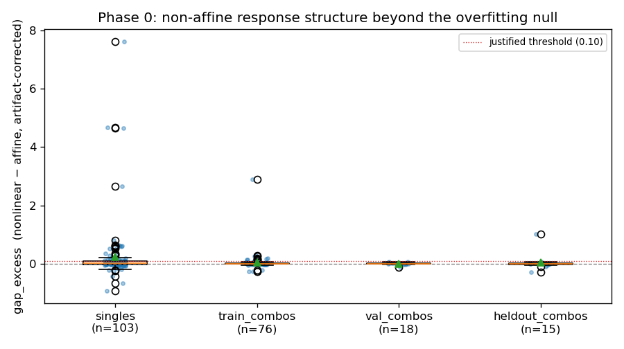

# 0. The premise as a number

*Before reshaping an encoder so that perturbations act linearly in its latent space, check whether they already do. This chapter builds the instrument that answers that question on the frozen encoder, explains the three guards it needs to give an honest answer from a few hundred unpaired cells, and reads the result. The short version: the response is close to affine wherever it can be measured, and that changes which phase of the co-adaptation program is worth building first.*

---

## Where we are

Four rounds of the perturbation-response project held the JEPA encoder frozen. That choice was deliberate. With the encoder fixed, a difference between two models could be attributed to the one stage that changed, and the [results ledger](../../docs/conditional-flow-jepa/results-ledger.md) depends on that. By the end of round 4, though, two separate measurements had pointed at the encoder itself.

The first measurement said the encoder **kept the signal**. A plain ridge regression from the frozen latents to the perturbed expression profile scores $0.852$ in effect-size correlation, above the from-scratch NB-VAE's $0.766$. Whatever the encoder discards, it does not discard the perturbation response.

The second measurement said the encoder **did not put that signal where the operator expected it**. The action operator models a perturbation $p$ as a matrix $A_p = \exp(M_p)$ acting on a cell's latent vector $z$. Here $M_p$ is a square matrix called the *generator*, and $\exp$ is the matrix exponential. If the perturbation is a gentle nudge, $M_p$ is small and $A_p$ is close to the identity matrix $I$. Round 4 found the opposite. To fit the data, the generators grew to a median Frobenius norm $\lVert M_p \rVert_F$ of about $12.4$. The Frobenius norm is the square root of the sum of a matrix's squared entries, so a value of $12$ describes a large transformation, not a nudge.

The [action-operator series](../../docs/action-operator/index.md) gives the reason this matters. A linear operator is only a faithful model of an intervention when the encoder's coordinates are *Koopman coordinates*, meaning coordinates in which the intervention acts linearly. [Chapter 2, §6](../../docs/action-operator/02-why-linear-koopman.md#6-the-premise-and-the-bridge-are-the-same-equation) shows that this is the same condition as the operator being equivariant. A JEPA encoder trained by masked prediction was never asked to provide such coordinates, so there was no reason to expect it to.

The co-adaptation program relaxes the freeze, one stage at a time. Its most ambitious phase, Phase 2, would retrain the encoder together with the operator so that perturbations become linear in the new coordinates. That is delicate engineering. Phase 0 asks, cheaply and first, whether the frozen coordinates are already close to linear.

## 1. Two readings of a large generator

A large generator has two possible explanations, and they lead to different programs.

**Reading one: the response is large but affine.** Suppose the perturbation moves every cell by a rotation, a stretch and a shift, all applied the same way everywhere in latent space. That is an *affine* map, $z \mapsto Az + b$, with $A$ a matrix and $b$ a vector. An affine map can be very far from the identity. Its matrix can have a large norm and still be exactly the right model. Under this reading, the latent space already supplies Koopman coordinates for the perturbation. What failed in round 4 was the extra assumption that the map is *close to the identity*.

**Reading two: the response is genuinely nonlinear.** Suppose instead that cells in one region of latent space move one way and cells in another region move a different way, in a pattern no single matrix can reproduce. Then the operator inflated its generator trying to approximate a curved map with a straight one, and the coordinates are not Koopman coordinates. Retraining the encoder to straighten them out, which is Phase 2's job, would be justified.

[Chapter 2, §10](../../docs/action-operator/02-why-linear-koopman.md#10-how-you-would-actually-check-it) of the action-operator series describes the test that separates these readings. Fit the best affine map from control to perturbed latents. Fit a flexible nonlinear map to the same data. If the nonlinear map does not do clearly better, the response is affine and reading one holds. If it does clearly better, reading two holds.

The same section adds one firm instruction: **do not run this test on the downstream benchmark.** The ceiling analysis showed that a perfect transition stage would improve effect size by at most $0.03$. A metric with so little room cannot tell a linear transition from a nonlinear one. The test therefore has to live entirely in latent space, with no decoder and no effect-size score.

## 2. Why the obvious version of the test does not work

The textbook form of the test needs **paired data**: the latent of a cell before the perturbation, $z$, and the latent of the same cell after it, $z'$. Fit both maps, compare their prediction errors on held-out pairs, and you are done.

Single-cell sequencing destroys the cell it measures, so no such pairs exist. The data contains a population of control cells and a separate population of perturbed cells. All we can ask of a map is whether it carries the **control cloud** onto the **perturbed cloud** as a whole.

Comparing two clouds needs a distance between distributions, and the project's standing choice is the **energy distance**. For two distributions $P$ and $Q$, let $x$ and $x'$ be independent draws from $P$, and let $y$ and $y'$ be independent draws from $Q$. Writing $\lVert \cdot \rVert$ for ordinary Euclidean length and $\mathbb{E}$ for an expectation, the energy distance is

$$\mathcal{E}(P, Q) = 2 \mathbb{E} \lVert x - y \rVert - \mathbb{E} \lVert x - x' \rVert - \mathbb{E} \lVert y - y' \rVert .$$

Read it in words: the average distance *between* the two clouds, counted twice, minus the average distance *within* each cloud. If the two distributions are identical, the between-cloud and within-cloud distances balance and $\mathcal{E}$ is zero. Otherwise it is positive, and it grows as the clouds separate or change shape. It needs no correspondence between individual points, which is exactly what unpaired data requires. Every operator round trained on this same objective.

Phase 0 therefore compares two maps by how close each one brings the transformed control cloud to the real perturbed cloud, measured in energy distance.

## 3. The instrument

Everything below happens for one perturbation $p$ at a time, on the frozen encoder's latents.

### The two arms

**The affine arm.** The map is $L(z) = Az + b$. It starts from the best affine map available in closed form: the one that sends a Gaussian with the control cloud's mean $\mu_c$ and covariance $\Sigma_c$ exactly onto a Gaussian with the perturbed cloud's mean $\mu_p$ and covariance $\Sigma_p$. In optimal-transport terms this is the *Bures map*,

$$A_0 = \Sigma_c^{-1/2} \left( \Sigma_c^{1/2} \Sigma_p \Sigma_c^{1/2} \right)^{1/2} \Sigma_c^{-1/2}, \qquad b_0 = \mu_p - A_0 \mu_c ,$$

where a matrix raised to the power $1/2$ means its symmetric square root. The covariances are shrunk slightly toward a multiple of the identity so the square roots stay well conditioned with a few hundred cells. From $(A_0, b_0)$ the map is fine-tuned by gradient descent on the energy distance. Starting at the moment-matching optimum is a deliberate choice: the affine arm cannot lose because it was badly initialized or under-trained, so any advantage the nonlinear arm shows is not a story about a weak linear baseline.

**The nonlinear arm.** The map is $N(z) = z + h(z)$, where $h$ is a small multilayer perceptron with one hidden layer of 64 units. Its last layer starts at zero, so $N$ begins as the identity and has to earn every departure from it. It is weight-decayed and trained on the same energy-distance objective.

### Fitting and scoring on different cells

Each cloud is split in half. The **fit half** trains the maps, with a slice held back as a validation set for early stopping, so each map is kept at the point where it generalizes best rather than where it memorizes its training cells. The **evaluation half** is used only for scoring. Without this split, a flexible map could match a finite cloud point by point and win for no reason related to biology.

### A ladder of distances

On the evaluation half, five energy distances are computed. Each is a rung on a ladder from "do nothing" to "noise floor".

| rung | compares | what it measures |
|---|---|---|
| $E_{\mathrm{id}}$ | control vs perturbed | how far the perturbation moves the cloud if you do nothing |
| $E_{\mathrm{shift}}$ | control moved by the mean difference vs perturbed | the crudest model: shift every cell by the same vector |
| $E_{\mathrm{lin}}$ | $L$(control) vs perturbed | what the best affine map leaves unexplained |
| $E_{\mathrm{nl}}$ | $N$(control) vs perturbed | what the nonlinear map leaves unexplained |
| $E_{\mathrm{floor}}$ | one half of the perturbed cloud vs the other half | the distance two samples of the *same* population show, from finite sampling alone |

The useful size of the response is the distance between the top and the bottom of the ladder, $E_{\mathrm{id}} - E_{\mathrm{floor}}$. No map can be expected to do better than the floor, so this is the part of the response that is actually there to be explained.

Each arm $x$ then gets a **reduction**, the fraction of that measurable response it removes:

$$\rho_x = \frac{E_{\mathrm{id}} - E_x}{E_{\mathrm{id}} - E_{\mathrm{floor}}} .$$

A reduction of $1$ means the map brings the control cloud all the way down to the floor. A reduction of $0$ means it does no better than leaving the cells alone. A negative reduction means it makes things worse.

The quantity Phase 0 is after is the **nonlinear gap**, the extra fraction of the response that the nonlinear arm explains beyond the affine arm:

$$g = \rho_{\mathrm{nl}} - \rho_{\mathrm{lin}} = \frac{E_{\mathrm{lin}} - E_{\mathrm{nl}}}{E_{\mathrm{id}} - E_{\mathrm{floor}}} .$$

The second form is the easiest to read: how much further the nonlinear map gets, as a share of how far there was to go.

### A worked example: TP73

Take the single-gene perturbation that activates *TP73*, one of the 103 single-gene perturbations with enough cells to probe. These are its numbers, averaged over three random splits of the cells and rounded.

The perturbation moves the cloud a long way: $E_{\mathrm{id}} = 0.555$, against a sampling floor of $E_{\mathrm{floor}} = 0.018$. The measurable response is therefore $0.555 - 0.018 = 0.537$.

Shifting every control cell by the mean difference brings the distance down to $E_{\mathrm{shift}} \approx 0.125$, a reduction of $(0.555 - 0.125) / 0.537 = 0.80$. A single vector already explains four fifths of this response.

The affine map reaches $E_{\mathrm{lin}} \approx 0.075$, so $\rho_{\mathrm{lin}} = (0.555 - 0.075) / 0.537 = 0.89$. Rotating and stretching the cloud, on top of shifting it, explains another nine percent.

The nonlinear map reaches $E_{\mathrm{nl}} \approx 0.067$, so $\rho_{\mathrm{nl}} = 0.91$. The nonlinear gap is

$$g = \frac{0.075 - 0.067}{0.537} \approx 0.015 .$$

So for *TP73*, a flexible nonlinear map explains about one and a half percent more of the response than the best affine map. That looks small, but the instrument is not yet calibrated: a flexible map can win by a little purely because it is flexible. The next section deals with that.

## 4. Three guards, and why each is needed

Fitting maps between 20-dimensional clouds of a few hundred cells is a regime where an instrument can report structure that is not there. Each guard below exists because, without it, the probe would answer a different question from the one being asked.

### Guard one: an unbiased distance

The energy distance has to be estimated from samples. The simplest estimator averages each within-cloud distance over all ordered pairs of points, *including each point paired with itself*. Those self-pairs contribute zeros, which drags the within-cloud averages down and pushes the estimate up. The bias grows as the cloud shrinks.

That matters here because the floor $E_{\mathrm{floor}}$ is computed on half-size clouds while the other rungs use full evaluation clouds. With the biased estimator, the floor can come out *above* $E_{\mathrm{id}}$, the denominator of every reduction turns negative, and the ratios become meaningless. Scoring therefore uses the unbiased estimator, which excludes self-pairs by dividing the within-cloud sums by $n(n-1)$ instead of $n^2$ for a cloud of $n$ points. Its expected value is exactly zero for two samples of the same population at any size, so rungs computed on clouds of different sizes can be compared. The biased version is kept only as the training loss, where its consistency across minibatches is what matters.

### Guard two: a principal subspace

The encoder's latent has 256 dimensions. A free affine map in 256 dimensions has $256 \times 256 + 256 = 65{,}792$ parameters, and a covariance matrix in 256 dimensions cannot be estimated from a few hundred cells. Fitted at full size, the affine arm generalizes *worse than doing nothing*.

So the probe works in the top $k = 20$ principal components of the latents. These are fitted on a pool that contains both control cells and a sample from every perturbation, so the directions in which perturbations move cells are represented, not only the directions in which control cells already vary. Each component is then rescaled by the control cloud's spread. Both steps are affine, so they cannot turn an affine response into a nonlinear one or the reverse. They only make the fits well posed.

The cost is coverage. The encoder spreads its variance widely, with an effective rank of about 176, so 20 components hold only **17% of the latent variance**. The conclusion of this chapter is therefore bounded to that subspace, and §7 comes back to what that does and does not allow us to say.

### Guard three: a synthetic affine null

Even in the subspace, the nonlinear arm has an edge that has nothing to do with biology. It is more flexible, so on finite clouds it can find small improvements that are really sampling noise. The question is how large that edge is.

The probe measures it directly. For each perturbation it builds a synthetic perturbed cloud that is *exactly* an affine image of control: it fits the Bures map from control to the real perturbed cloud, then applies that map to a fresh, independent sample of control cells. The synthetic cloud has the same size, mean and covariance as the real one, but its true nonlinear gap is zero by construction. The full instrument is run on it, and whatever gap it reports, $g_{\mathrm{null}}$, is pure artifact.

The calibrated signal is the difference:

$$g_{\mathrm{excess}} = g_{\mathrm{real}} - g_{\mathrm{null}} .$$

In words, $g_{\mathrm{excess}}$ is the fraction of the measurable response that a nonlinear map explains beyond the best affine map, after subtracting the advantage a nonlinear map shows even when the truth is affine.

For *TP73*, $g_{\mathrm{real}} = 0.015$ and $g_{\mathrm{null}} = -0.002$, so $g_{\mathrm{excess}} \approx 0.017$.

The null also gives the instrument an **acceptance gate**. If the median artifact $g_{\mathrm{null}}$ is itself large, the subtraction is being asked to cancel too much and the result cannot be trusted. The gate requires the median $g_{\mathrm{null}}$ to stay at or below $0.05$. At $k = 20$ it is $0.008$ and at $k = 32$ it is $0.030$, so both pass. At $k = 48$ it rises to $0.107$ and the gate rejects the configuration, which is the null doing its job: in 48 dimensions the clouds are too thin for the fits to be trusted.

## 5. The rule, fixed before the numbers

The decision rule was set before the aggregate results were read, and it is evaluated on the **single-gene perturbations**. They are the cleanest interventions in the dataset and, at 103 perturbations, the only stratum large enough to decide anything. The training, validation and held-out combinations are reported alongside them as secondary strata.

| verdict | condition on the median $g_{\mathrm{excess}}$ across singles | what follows |
|---|---|---|
| **Phase 2 justified** | at least $0.10$, with a 95% bootstrap interval that excludes zero | the frozen coordinates are not Koopman coordinates; retraining the encoder with the operator is worth its cost |
| **Phase 2 not justified** | below $0.03$, with an interval that includes zero | the response is affine wherever it can be measured; the bottleneck is downstream |
| **Inconclusive** | anything else | proceed with Phase 1, revisit Phase 2 later |

The threshold of $0.10$ asks for a nonlinear advantage of at least a tenth of the measurable response before it is worth reshaping an encoder over. The interval comes from resampling perturbations with replacement 2,000 times.

The rule was originally written on the raw gap $g_{\mathrm{real}}$. It was moved to the calibrated $g_{\mathrm{excess}}$ once the synthetic null showed that the raw gap is partly an artifact of fitting, and that change was made before the aggregate was looked at.

Two scope notes. Phase 0 gates **Phase 2 only**. Phase 1, which trains the encoder jointly with the decoder, goes ahead whatever Phase 0 says, because it targets a different and already-measured loss. And a perturbation enters a stratum only if it has at least 150 cells, which is why the held-out stratum has 15 combinations rather than 20.

## 6. The result

Three random splits of the cells, 20 principal components, the gate passed. Every column from $g_{\mathrm{real}}$ onward is a median across that stratum's perturbations.

| stratum | perturbations | median $g_{\mathrm{excess}}$ | 95% interval | $g_{\mathrm{real}}$ | $g_{\mathrm{null}}$ | $\rho_{\mathrm{shift}}$ | $\rho_{\mathrm{lin}}$ | $\rho_{\mathrm{nl}}$ |
|---|---|---|---|---|---|---|---|---|
| **singles** (primary) | 103 | **0.015** | **[0.003, 0.032]** | 0.024 | 0.008 | 0.72 | 0.76 | 0.80 |
| training combinations | 76 | 0.004 | [−0.002, 0.012] | 0.002 | −0.003 | 0.84 | 0.89 | 0.89 |
| validation combinations | 18 | 0.010 | [−0.003, 0.028] | −0.002 | −0.005 | 0.85 | 0.91 | 0.90 |
| held-out combinations | 15 | 0.010 | [−0.011, 0.023] | 0.006 | −0.002 | 0.78 | 0.88 | 0.88 |

The seed-to-seed spread of the stratum medians is about $0.009$, smaller than any difference this chapter relies on.

**By the letter of the rule, the verdict is inconclusive.** The interval for the singles excludes zero, so the nonlinear advantage is detectable. But its median, $0.015$, is far below the $0.10$ needed to justify Phase 2. It falls between the two thresholds, which is exactly the region the rule labels inconclusive.

**In substance, the response is close to affine.** A nonlinear map explains about one and a half percent more of the response than the best affine map. For the combinations, the advantage is smaller still and its intervals include zero.



*Each dot is one perturbation's $g_{\mathrm{excess}}$, averaged over three seeds. The boxes are tight around zero, and the dotted line at $0.10$ is the threshold that would have justified Phase 2. The scattered points far above it are explained below.*

### The tail belongs to perturbations that barely move the cloud

The figure shows a handful of singles with very large values, up to about 7.6. A quarter of the singles individually exceed $0.10$. That looks like it contradicts the median, so it is worth checking where those values come from. What follows is an exploratory analysis made after the rule was applied, not part of the pre-registered test.

Sort the singles by the size of their measurable response, $E_{\mathrm{id}} - E_{\mathrm{floor}}$, and split them at the median.

| singles | perturbations | median $g_{\mathrm{excess}}$ | share above $0.10$ | share where the affine map does worse than nothing |
|---|---|---|---|---|
| strong responders (top half) | 52 | 0.005 | 4% | 0% |
| weak responders (bottom half) | 51 | 0.082 | 47% | 29% |

Among the perturbations that clearly move the cloud, the nonlinear advantage is half a percent, and only 2 of 52 exceed the threshold. The large values come almost entirely from perturbations whose response is barely above the sampling floor.

The mechanism is visible in a single case. Activating *KIF18B* moves the cloud only slightly: $E_{\mathrm{id}} = 0.025$, against a floor near zero. With so little response to fit, estimating a 20-by-20 matrix and a shift from a few hundred cells mostly fits noise. The affine map ends up moving the control cloud *further* from the perturbed one, with $E_{\mathrm{lin}} \approx 0.124$ and a reduction of $-4.0$. The nonlinear map starts at the identity and, because training stops early on validation, stays near it, so its reduction is a modest $0.47$. Divide that difference by a denominator of $0.025$ and the gap comes out at $4.5$. That number does not mean the response is nonlinear. It means the affine fit failed on a perturbation with almost nothing to fit, and a ratio with a near-zero denominator magnified the failure.

This is why the rule is stated on a **median** across perturbations rather than a mean. It also says that wherever the response is large enough to measure well, the affine reading holds even more clearly than the headline suggests.

### Two robustness checks

**More dimensions.** Repeating the probe at $k = 32$ components, which hold about a quarter of the latent variance, gives a singles median of $0.021$ with interval $[0.010, 0.044]$, still well below $0.10$. Raising $k$ further fails the acceptance gate, as described in §4.

**More capacity.** A real nonlinear structure should become easier to capture as the nonlinear map gets more hidden units. On a sample of eight singles, the median $g_{\mathrm{excess}}$ at 8, 32 and 128 hidden units is $-0.035$, $0.155$ and $0.001$. There is no steady rise with capacity, which is what fitting noise looks like. With eight perturbations and one seed, this is a sanity check rather than a measurement.

## 7. What it means

### The large generator was large, not curved

This settles the puzzle from round 4. The operator's generators grew to a norm of about 12 because the response really is a large transformation in these coordinates, and Phase 0 shows that transformation is close to affine. Reading one from §1 holds: the coordinates are close to Koopman coordinates in the measurable subspace. What failed in round 4 was not the assumption of linearity but the assumption of **near-identity**, the idea that a perturbation is a small motion in latent space.

The two assumptions are often stated together, so separating them is useful. *Linearity* is a claim about the shape of the map, and Phase 0 says it is largely earned. *Near-identity* is a claim about the size of the map, and round 4 showed it is false in this encoder's coordinates. Round 4 traced why: the near-identity prior comes from expression space, where a perturbation changes a handful of genes out of thousands. That statement does not survive the trip through the encoder, where the same response becomes a large rotation.

### How small is small

Three reference points put $0.015$ in proportion.

- **Against the response itself.** It is one and a half percent of the measurable response. The affine map already explains about three quarters of the response for the median single, and a single mean-shift vector explains most of that.
- **Against the bar.** It is less than a sixth of the $0.10$ that would have justified Phase 2.
- **Against the competing bottleneck.** The ceiling analysis found that the trained count decoder loses $0.173$ in effect-size correlation relative to a linear readout of the same latents. These are different units, a share of a latent-space distance on one side and a correlation on the other, so the comparison is about priority, not arithmetic. One loss is large and measured; the other is barely detectable.

### What it decides, and what it leaves open

**Phase 1 comes next.** Training the encoder jointly with the decoder targets the $0.173$, the largest measured term in the loss budget. It keeps the transition frozen, so any gain stays attributable. It was always going to run, and Phase 0 gives no reason to put anything ahead of it.

**Phase 2 loses its first motive but not its second.** Phase 2 was motivated in two ways. The first was *linearization*: reshape the encoder so that perturbations act linearly. Phase 0 says that is largely unnecessary, because they already do in the measurable subspace. The second is *re-coordinatization*: reshape the encoder so that perturbations become small, well-conditioned motions, which would let a near-identity prior and the operator's composition algebra apply. Phase 0 does not test that motive at all. It remains an open question rather than a refuted one.

## 8. What this measurement cannot see

Three limits bound the conclusion, and each is a property of the data or the instrument rather than a flaw to be fixed later.

**It sees only the measurable subspace.** Twenty components hold 17% of the latent variance. A nonlinear response living entirely in the other 83% would be invisible here. But those low-variance directions are also where a few hundred cells cannot pin down any map, affine or not, so an operator trained on the same data would face the same blindness.

**It sees distributions, not cells.** Because the data is unpaired, the probe asks whether an affine map can reproduce the perturbed *distribution*. Two maps that produce the same output distribution are indistinguishable to it, even if they move individual cells differently. "The response is affine" therefore means "an affine map is sufficient to produce the response as a population". That is the claim a population-level model needs, and it is the strongest claim destructive measurement allows.

**It is a statement about this encoder.** Every number here is conditional on the frozen JEPA encoder. A co-adapted encoder has different coordinates, and the probe would have to be run again on it, just as the ceiling has to be re-measured for every new encoder.

## 9. Reproducing it

The probe trains nothing on the encoder and runs on CPU in a few minutes.

```bash
python examples/perturbation_response/co-adaptation/01_koopman_linearity_probe.py \
    --encoder output/norman_stage_a/checkpoints/encoder.pt --split combo \
    --pca-dim 20 --seeds 3 --steps 300
```

It writes `output/norman_koopman_probe/reports/koopman_probe.json`, with the per-stratum summary, every perturbation's ladder, the capacity sweep and the decision block, plus the figure above as `samples/koopman_gap.png`. Pass `--pca-dim 32` for the robustness check, and `--pca-dim 48` to watch the acceptance gate reject a configuration.

---

*Up: [the co-adaptation series](index.md). The theory this chapter tests: [action operators, chapter 2](../../docs/action-operator/02-why-linear-koopman.md). The scoreboard it joins: [the results ledger](../../docs/conditional-flow-jepa/results-ledger.md), round 5. Next: chapter 1, co-adapting the encoder with the decoder.*
