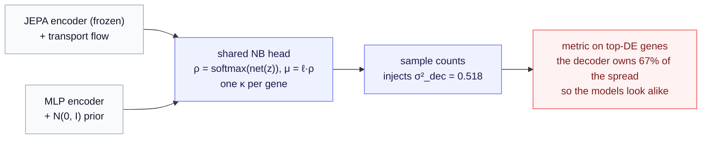

# Chapter 6 — Beyond the current limit

*Where a breakthrough would most plausibly come from. The method loses to a simpler baseline, and a loss of this size is not something a tuning pass repairs. It is a map of which components have to change, and by how much. This chapter orders the directions from the ones most likely to move the number to the deeper research bets, and says for each what we would expect to see.*

The result to beat, from [Chapter 4](04-results.md): on held-out gene combinations a from-scratch NB-VAE scores $0.766$ against the conditional flow's $0.648$, a gap of $0.118$ that survives correction for the whole family of comparisons, against a baseline whose seed-to-seed spread is $0.006$. Reseeding will not close it, and neither will a lever worth $+0.02$. Whatever comes next has to be structural. Round 6 of the [results ledger](../results/round-06-conditioned-encoder.md) later raised the learned baseline itself to $0.858$, by letting its encoder read the perturbation as well as the cell, which leaves the flow about $0.21$ behind. Round 7 then set the current reference on this endpoint without training anything: the additive prediction, the sum of the two measured single-gene effects, scores $0.961$, significantly above every learned model. So the result to beat on $\Delta$-correlation is now $0.961$, and a lever that only overtakes the VAE has not beaten the strongest tested reference. The additive reference predicts a mean and no cells, so on the calibration axis the VAE remains the comparison. Every number in this paragraph was later re-read under the corrected count likelihood of [round 11](../results/round-11-library-size.md): the conditioned NB-VAE scores $0.939$, the transport flow $0.837$, and the additive reference, which uses no decoder, is unchanged ([the re-baseline](../results/rebaseline-after-round-11.md)). The order of the models is the same, and the distances are smaller.

[Chapter 5](05-challenges-and-limitations.md) traced the loss to three facts, worth restating here because each one is a lever this chapter reaches for. First, the encoder is frozen and condition-blind: it is pretrained on cell states alone and never sees the intervention, so all conditioning lives downstream in the flow and the representation itself is never shaped by the perturbation task. Second, the decoder is a shared bottleneck: the flow and the VAE read out through the same negative-binomial head, that head carries the large majority of the predicted spread on the genes the metric scores, and so whatever differs in the parts the two models do *not* share gets compressed at the output. Third, the metrics reward the mean and the marginals, which is precisely what a simple conditional generator already handles well, while the flow's distinctive promise of a rich and possibly multimodal joint distribution over the response is the hardest thing to measure and the least rewarded. Each fact is a lever, and the sections below are ordered by how readily each one moves.

Several of these levers have since been built and measured, and the [results ledger](../results/index.md) records each round. The decoder levers ran in Round 2, the operator route of the transition ran in Rounds 3 and 4, and the encoder began to be unfrozen in Round 5. Between them, a ceiling analysis relocated where the loss lives. Handing the pipeline the real held-out perturbed latents, a transition that is perfect by construction, scores only $0.679$ through the trained decoder, while a plain linear readout of the same frozen latents scores $0.852$. The transition was therefore never where the gap could close. The decoder's part of that loss turned out to be a calibration error with a single cause: [round 11](../results/round-11-library-size.md) found that the decoder's likelihood counted the library size over all measured genes rather than the 5,000 it models, and with that corrected the same readout scores $0.865$, slightly above the linear one. [Round 12](../results/round-12-coadaptation.md) then let the encoder and the decoder train together, and the readout rose to $0.936$. [Round 13](../results/round-13-random-start.md) ran the same training from a random start and reached $0.948$ to $0.961$, so at full data the JEPA pretraining is not established to contribute once the encoder is trained by reconstruction. Data efficiency, the first section below, is the premise that result leaves open, and it has still not been run. The sections keep the reasoning that motivated each lever and say, where it applies, what the measurement later showed.

## The one axis we have not measured: data efficiency

The cleanest remaining place for the flow to justify itself is the low-data regime. The whole premise of self-supervised pretraining is that a representation learned on abundant unlabeled cells pays off when labeled examples are scarce. Effect size at full data does not test that premise at all. The experiment is to subsample the training cells per perturbation to a ladder of fractions, retrain the flow and the VAE at each rung, and plot the $\Delta$-correlation against the number of cells. If the JEPA-plus-flow stack degrades more gracefully than the from-scratch VAE as data shrinks, that is a real and practically important win, and it is invisible to every number reported so far. It was ranked the first thing to run, and it is still unrun: every number in the [results ledger](../results/index.md) is a full-data number, so none of them tests this premise. It needs only the existing pipeline with a subsampling flag.

## Fix the shared bottleneck: a better-calibrated decoder

Why bother with the decoder at all? Because on the calibration axis it is doing most of the talking. The decoder carries the larger part of the spread the predicted populations have, so a calibration number reports partly on the readout rather than on the generative model behind it, and any advantage the flow's latent distribution might hold is diluted by it. A piece of exact algebra says by how much.

Both models generate a cell in the same two steps: draw a latent from the model's own distribution, $z \sim p(z \mid \text{pert})$, then draw counts from the decoder, $x \mid z \sim \mathrm{NB}(\mu(z), \kappa)$. The law of total variance splits the spread of the resulting population into exactly two pieces, one contributed by each step:

$$\underbrace{\mathrm{Var}[x_g]}_{\sigma_{\text{obs}}^2} = \underbrace{\mathbb{E}_z\big[\mu_g(z) + \mu_g(z)^2/\kappa_g\big]}_{\sigma_{\text{dec}}^2} + \underbrace{\mathrm{Var}_z\big[\mu_g(z)\big]}_{\sigma_{\text{bio}}^2}.$$

This is an identity rather than a modeling approximation, and it is worth reading slowly, because it assigns every unit of observed spread to an owner. Here $x_g$ is the count of gene $g$, $\mu_g(z)$ is the mean the decoder emits for a cell at latent $z$, and $\kappa_g$ is the negative binomial's dispersion. The second term on the right, $\mathrm{Var}_z[\mu_g(z)]$, is the variance of the decoded *mean* across the latent cloud: cells differ from one another because the model placed them at different latents. That is $\sigma^2_{\text{bio}}$, and it is precisely the part the flow and the VAE do differently, because it is set entirely by their latent distributions. The first term is the count noise the decoder adds around each cell's own mean, averaged over the cloud. That is $\sigma^2_{\text{dec}}$, it belongs to the shared readout, and it is the same kind of object in both models. The benchmark measures both terms by sampling, on the expression it scores, the log1p-CP10K of sampled counts. The law of total variance holds there just as exactly, since it holds for any function of the counts; only the closed form for $\sigma^2_{\text{dec}}$ written above is specific to raw counts.

Measured on the transport flow, over the genes the metric scores, with the sampled counts normalized the way the data was ([the re-baseline](../results/rebaseline-after-round-11.md)):

$$\sigma^2_{\text{dec}} = 0.518, \qquad \sigma^2_{\text{bio}} = 0.256, \qquad \text{total} = 0.774, \qquad \text{real} = 0.824 .$$

Two things fall out. The total is close to right: pair by pair, the flow's populations carry $0.97$ of the real cells' variance, and its central $80\%$ interval covers $0.77$ of the real cells against a nominal $0.80$. And the decoder owns two-thirds of that spread, outweighing the latent distribution by two to one. **That ratio is the compression.** The metric sees $\sigma^2_{\text{obs}}$, the decoder supplies most of it, and so two models with different latent distributions land closer together than their latent distributions are.

The two boxes on the left are the only place the models differ, and they are exactly what $\sigma^2_{\text{bio}}$ measures. Everything downstream of the merge is shared. The condition-blind NB-VAE, measured the same way, has a latent contribution of $0.212$ against the flow's $0.256$, and a latent share of $33\%$ against the flow's $32\%$, so the two models do not differ much in what their latent distributions add to the spread.

### What the populations' width was, and what it was not

The benchmark first reported every model as badly **under-dispersed**: the predicted $80\%$ interval captured only about $37\%$ of the real held-out cells, and the same decomposition gave the flow $\sigma^2_{\text{dec}} = 0.538$ and $\sigma^2_{\text{bio}} = 0.140$, a total of $0.678$ against the real $0.824$. Most of that narrowness came from how sampled counts were turned into expression, not from the models. The measured data was normalized by dividing each cell by its own total over the modeled genes. The benchmark divided each sampled cell by a fixed sampling depth instead. Those agree only when every sampled cell has the depth's total, and the original decoder's sampled totals varied four to six times as much from cell to cell as real cells' do. [Round 11](../results/round-11-library-size.md) traced that variation to the library size in the decoder's likelihood, counted over all genes, and found that normalizing like the data at the real depth moves the same populations from $0.38$ to $0.80$ coverage. With the library size corrected as well, every model covers between $0.73$ and $0.80$.

The identity still carries the lesson it was first used for. A shortfall in variance can be closed in two places, and they are not equivalent. Raising the decoder's count noise fixes coverage by enlarging the shared component, which makes a better latent distribution even harder to see. Raising the latent distribution's spread fixes coverage and makes the generative model a larger part of what the metric sees, which is the only way its quality can register. Under the corrected conventions the shortfall is small, about $0.05$, so the choice now moves the latent share only between about $31\%$ and $37\%$. The rule remains the right one for any lever aimed at calibration: prefer the fix that grows $\sigma^2_{\text{bio}}$.

What now separates the models is not width but the per-gene structure of their populations. On the same genes the conditioned NB-VAE's spread correlation, the correlation of per-gene standard deviations between predicted and real cells, is $0.82$, against $0.66$ for the flow; its per-gene Wasserstein distance is $0.26$ against $0.41$, and its joint energy distance $0.36$ against $0.92$. Those are the axes a calibration lever has to move.

So the decoder work that remains is narrow. The readout's mean head can be anchored so that it models the deviation from baseline rather than the whole absolute profile, and the dispersion can be checked against the residual the identity names, $\sigma^2_{\text{dec}} \to \mathrm{Var}[x_g] - \sigma^2_{\text{bio}}$, which is now about $0.57$ against the $0.52$ delivered ([Chapter 8](08-modeling-the-readout-count-decoder.md) develops both). On the effect-size axis the decoder was, for a while, the largest single lever on the table. The ceiling analysis found that the trained decoder lost $0.173$ of $\Delta$-correlation that a linear readout of the same frozen latents recovers. [Round 10](../results/round-10-control-reference.md) showed that the loss was a shift, the decoded profile sitting about $0.55$ below measured expression on the scored genes and the same for every condition, and [round 11](../results/round-11-library-size.md) found its cause in the likelihood's library size and removed it. Round 2 had built two decoder changes before any of this was known. Its dispersion arm was aimed at *narrowing* a decoder believed to be over-dispersed, so its numbers carry no information; the anchored mean head was not re-measured. Two cautions ride along: the zero-inflated variant the code supports is tempting for dropout-heavy data, but modern UMI counts are generally not zero-inflated and a dropout gate can mask a dispersion problem rather than fix it; and any loss reweighting must use answer-agnostic signals only.

For calibration, the main event is the latent distribution, and the section on conditioning below is where it lives. The operator route of [Chapter 7](07-modeling-the-transition-action-operators.md), with its dialable residual velocity field, was proposed as the most direct way to make the predicted cloud wider in a structured way rather than merely noisier. Round 3 of the [results ledger](../results/round-03-action-operator.md) tested it. Under the corrected conventions the deterministic operator carries the largest latent share of any model, $35\%$ against the transport flow's $32\%$, and its populations match the real cells' variance pair by pair. The stochastic arm with a residual has the smallest, $21\%$. Neither changes the per-gene structure much: their spread correlations are $0.64$ and $0.66$, the same as the flow's.

## Give the metrics something the flow can win

A generative model's distinctive value is the full joint distribution of the response, including multimodality and gene-gene correlation, and that is the least-rewarded thing on the current scoreboard. Two changes would let the flow show an edge if it has one. First, build metrics that isolate joint structure from marginal noise, for instance comparing predicted and true gene-gene correlation matrices, or measuring how well each model reproduces a known bimodal response where cells split between two fates. Second, and harder, disentangle the biological variation the flow controls from the technical count noise the decoder adds, so that calibration reads the latent distribution rather than the decoder. Until the evaluation can see joint structure, a model that captures it well will keep scoring the same as one that does not.

## Move conditioning into the representation

The frozen, condition-blind encoder is a deliberate choice that buys modularity, and relaxing it is a spectrum rather than a switch. The gentlest step is joint training: stop freezing the encoder and let the conditional generative loss shape it, accepting some risk that the representation drifts from clean self-supervision. That step is now under way as the [co-adaptation program](../../co-adaptation/README.md), which unfreezes the encoder one stage at a time. Its first measurement, Round 5 of the [results ledger](../results/round-05-koopman-probe.md), found that the frozen latents already respond close to affinely to perturbations, so the program co-adapts the encoder with the decoder first. A middle step is condition injection, feeding the intervention into the encoder so its output is a state-under-condition rather than a pure state. The scalability of injection turns on how the condition is represented, and a parametric, compositional condition like the gene-set embedding is what lets it reach unbounded interventions.

The deepest step is to make the self-supervised task itself conditional. Pretrain the encoder with a predictor that is conditioned on an action and learns to predict the next latent from the current latent and that action. The representation is then perturbation-aware from the start, because the pretraining required it. This is the operator world model, where an intervention is read as an operator that drives a transition in latent space and the predictor *is* that conditioned transition. Reading the condition as a parametric operator $f_{\theta(c)}$ is also what makes rich conditioning scale, since the operator is generated from the structure of the intervention rather than enumerated over a fixed menu. The [design-space survey](../../../../docs/generative_jepa/10-route-d-world-model-planning.md) and the [operator world models](../../../../docs/generative_jepa/index.md) line develop this route, and it is the most substantial bet on the list, because it changes what the representation is for rather than only what happens downstream of it.

## Smaller levers worth pulling

Several cheaper experiments could sharpen the flow without changing its character. Optimal-transport coupling hurt when applied globally across mixed perturbations, but coupling *within* a perturbation, matching controls to targets of the same intervention, respects the conditioning the global version ignored and might help where the global version hurt. Classifier-free guidance was left at its neutral setting throughout, and a guidance sweep could trade diversity for sharpness in the predicted effect, with the sweet spot found against the $\Delta$-correlation. And the DeepSets variant of the gene-set embedding, which can model interactions a pure additive sum cannot, is worth testing on the combinations where two genes interact non-additively, the genuine epistasis that additivity is bound to miss.

One further lever sits earlier in the pipeline than any of these: how genes are grouped into tokens before Stage A. The default is a fixed random partition ([Chapter 3 §2](03-training-and-evaluation.md)). [Chapter 6a](06a-the-tokenization-design-space.md) develops the full design space: pathway groups, co-expression modules, the bias mechanisms each introduces, and how to test a swap without breaking the combo-split discipline.

## Buy statistical power

Every combination result rests on twenty held-out combinations, which limits resolution to roughly $0.05$. Norman 2019 contains far more combinations than we held out, so a larger held-out set, more training seeds, and ideally a second Perturb-seq dataset would let a real difference between the flow and the baseline become visible if one exists. This does not change the method, but without it a small genuine improvement cannot be told apart from noise. The baseline's lead is not in doubt, since it is about twenty times the VAE's seed-to-seed spread ([Chapter 4](04-results.md)). Smaller contrasts are another matter. Twenty perturbations leave even that lead's simultaneous interval with an upper edge of only $-0.008$, and between arms that sit close together individual seeds do reorder: on one seed the OT-coupled flow scores $0.634$ against the transport flow's $0.623$, the reverse of their seed-averaged order. That is why every comparison averages seeds before testing ([Chapter 4a](04a-reading-the-head-to-head.md)), and why a lever worth a few hundredths needs more perturbations to be seen at all.

## How we would read the outcomes

These directions are not equally likely to pay off, and it is worth being explicit about what each would mean. If data efficiency favors the flow, the method has a clear practical niche even at full-data parity, and that is the most likely near-term win. If a better decoder or a joint-structure metric reveals a gap, the flow's distributional modeling was real but hidden, and the contribution stands. If the operator route lifts the result, the value was never in bolting a flow onto a frozen encoder but in making conditioning native to the representation, which reframes the whole line of work. That branch has since been read, and it did not lift the result: the operator tied the flow in Round 3 ($-0.003$, not significant), its composition algebra was refuted in Round 4, and the ceiling showed the transition never had more than about $0.03$ to give ([results ledger](../results/index.md)). The outcome the list did not anticipate is the one the evidence now favors: the effect is present in the frozen representation and the decoder is losing it, which points at the mean head and at co-adapting the encoder with the decoder. And if none of them move the number, that is itself a clean and publishable conclusion: for this task, a simple conditional generator is enough, and the case for generative JEPA rests on the reusable encoder and transfer rather than on beating a baseline at effect size. Each outcome advances the understanding, which is the point of having measured the loss carefully enough to trust it.

---

*Previous: [Chapter 5: Challenges and limitations](05-challenges-and-limitations.md). Up: [the method series](index.md). Related: [Chapter 6a: The tokenization design space](06a-the-tokenization-design-space.md).*
